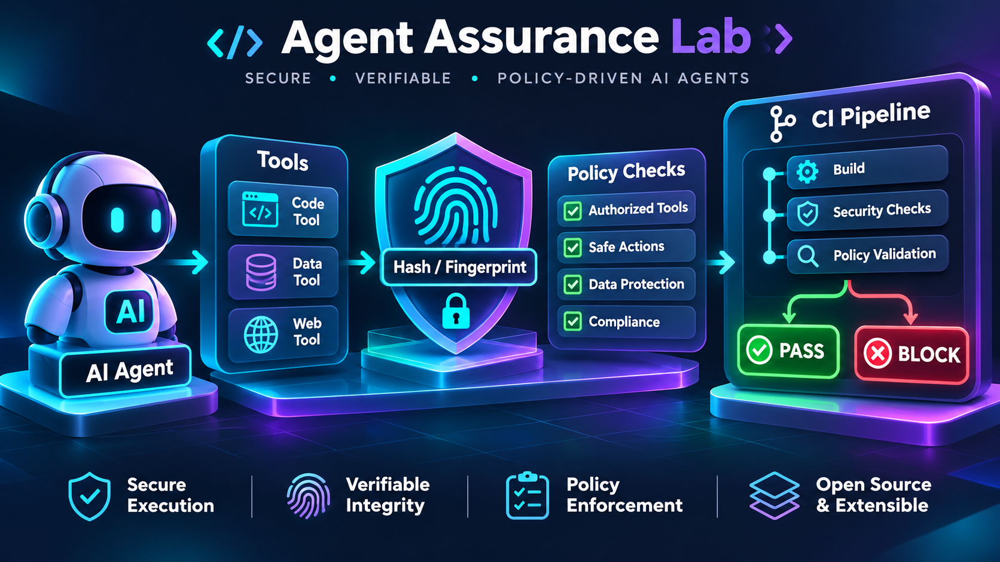

# Agent Assurance Lab

Deterministic assurance checks for AI agent tool definitions.



Agent Assurance Lab fingerprints the tool surface, evaluates local security policy, and records session evidence before an AI agent is allowed to continue.

The first MVP compares an approved tool manifest with an observed `tools/list` snapshot. It detects added, removed, and modified tools by hashing each tool's name, description, and `inputSchema` using canonical JSON.

## Quick start

```bash
python -m unittest discover -s tests
PYTHONPATH=src python -m agent_assurance.cli \
  --approved examples/approved.json \
  --observed examples/observed.json \
  --format text
```

The example intentionally fails because the observed snapshot contains a changed `read_file` definition and an unexpected `delete_file` tool. Use `--format json`, `--format sarif`, or `--format html --output report.html` for machine-readable and human-readable reports.

## Policy checks

Policies turn comparison findings into explicit security decisions. The example policy blocks newly added tools, blocks `delete_file`, and verifies that `read_file` remains read-only:

```bash
PYTHONPATH=src python -m agent_assurance.cli \
  --approved examples/approved.json \
  --observed examples/observed.json \
  --policy examples/policy.yml \
  --format html --output report.html
```

Use `error` findings to fail CI. Policies are local configuration; the tool does not send manifests or session data over the network.

## Session evidence

Pass a recorded session to detect calls to unknown tools and runtime effects that were not declared by the tool:

```bash
PYTHONPATH=src python -m agent_assurance.cli \
  --approved examples/approved.json \
  --observed examples/observed_pass.json \
  --session examples/session.json \
  --format json
```

The report preserves a session timeline and separates static surface changes from runtime findings. This distinction is important: a declaration-only check cannot prove what a handler actually did.

AgentReplay-style JSONL exports are also supported:

```bash
PYTHONPATH=src python -m agent_assurance.cli \
  --approved examples/approved.json \
  --observed examples/observed_pass.json \
  --session examples/agentreplay-session.jsonl \
  --session-format agentreplay-jsonl \
  --format json
```

## Reproducible attack demo

The repository includes two negative controls: static tool-surface drift and a runtime write performed by a tool declared as read-only. Both should be detected and return a non-zero exit status:

```bash
./scripts/attack-demo.sh
```

The complete scenario matrix is documented in [`docs/benchmark.md`](docs/benchmark.md). It is designed to run locally and in CI without network access or live agent execution.

## Signed approval evidence

Approval evidence uses Ed25519 signatures. Keep the private key outside the repository and publish only the evidence bundle or the public key.

```bash
agent-assurance-evidence generate-key --output approval-private.pem
agent-assurance-evidence export-public-key \
  --private-key approval-private.pem \
  --output approval-public.pem
agent-assurance-evidence sign \
  --manifest examples/approved.json \
  --private-key approval-private.pem \
  --output approval-evidence.json
agent-assurance-evidence verify --evidence approval-evidence.json
```

The bundle contains the canonical manifest hash, per-tool fingerprints, the signature algorithm, the signature, and the public key needed for local verification. In CI, pass the separately distributed `approval-public.pem`; the GitHub Action rejects an evidence bundle without it.

## GitHub Action

The repository includes a composite action that verifies signed evidence before comparing tool definitions and writes a SARIF report:

```yaml
- uses: pedronavarro-labs/agent-assurance-lab@main
  with:
    approved: security/approved.json
    observed: security/observed.json
    evidence: security/approval-evidence.json
    public-key: security/approval-public.pem
    policy: security/policy.yml
    session: security/session.json
    report: agent-assurance.sarif
```

The example workflow in `.github/workflows/agent-assurance.yml` runs tests and assurance checks on pushes, pull requests, or manually, then uploads the SARIF report to GitHub Code Scanning.

## Current scope

- Canonical SHA-256 fingerprints for tool definitions.
- Detection of added, removed, and modified tools.
- JSON, SARIF, HTML, and text reports.
- Non-zero exit status when the approved and observed surfaces differ.
- `listChanged` session signals are preserved in the result.
- YAML policy rules can block tools, added surfaces, unsafe declared effects, or `listChanged` events.
- Session evidence produces a timeline and detects undeclared runtime effects.
- Local HTML reports can be served with `agent-assurance-dashboard --report report.html`.
- No network access and no runtime agent execution.

## Roadmap

1. Integrate AgentReplay exporters directly.
2. Add compatibility modes for controlled manifest migrations.
3. Expand the reproducible security benchmark with adversarial fixtures.

## Synthetic fixtures

- `examples/list_changed_mid_session.json` demonstrates a changed tool definition after a `listChanged` event.
- `examples/read_only_declared_write_effect.json` documents the boundary between declarations and runtime behavior.
- See `docs/threat-model.md` for the interpretation of both cases.
